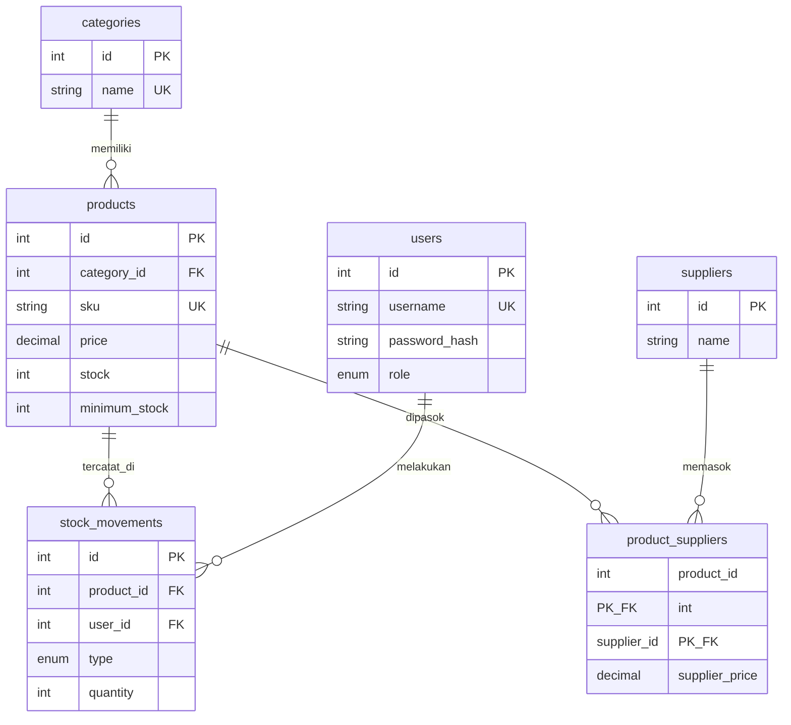

# Langkah Pengerjaan Mini Project 3 - Inventory Management System

## 0. Persiapan
1. Install XAMPP (PHP 8.1+ dan MySQL/MariaDB). Start **Apache** dan **MySQL**.
2. Salin folder `inventory-app` ke `C:\xampp\htdocs\`.
3. Buka `http://localhost/phpmyadmin` -> tab **Import** -> pilih `database/schema.sql` -> **Go**.
4. Cek `config/database.php`. Jika nama folder berbeda, ubah `BASE_URL`.
5. Buka `http://localhost/inventory-app/public/` -> login `admin / admin123`.

## 1. ERD dan schema.sql
Relasi:
- categories 1---N products (FK `products.category_id`)
- products N---N suppliers (junction `product_suppliers`)
- products 1---N stock_movements, users 1---N stock_movements

Cara mendapatkan gambar ERD untuk deliverable: salin kode Mermaid di atas ke https://mermaid.live (Export PNG), atau di phpMyAdmin buka database -> **Designer** lalu screenshot.

## 2. Login dan role admin/staff
File: `public/login.php`, `logout.php`, `helpers/auth.php`. Kuncinya: prepared statement, `password_verify`, `session_regenerate_id(true)`, `require_login()`, `require_role('admin')`.

## 3. Modul kategori dan produk
File: `public/categories/*`, `public/products/*`. Admin bisa CRUD; staff hanya melihat daftar produk.

## 4. Search, filter, sorting, pagination
File: `public/products/index.php`. Search nama/SKU (`LIKE`), filter `category_id`, sorting dengan **allowlist** kolom, pagination `LIMIT/OFFSET`, dan parameter dipertahankan lewat `build_query()`.

## 5. Barang masuk dan keluar dengan transaction
File: `helpers/stock.php`, `public/stock/in.php`, `out.php`, `history.php`. Alur: `BEGIN` -> `SELECT ... FOR UPDATE` -> validasi -> update stok -> insert histori -> `COMMIT` (atau `ROLLBACK`).

## 6. Dashboard sederhana
File: `public/dashboard.php`. Total produk, nilai inventory, stok rendah, total masuk, total keluar, ringkasan per kategori, laporan masuk vs keluar.

## 7. Pengujian wajib (ambil screenshot)
| Kasus | Langkah | Hasil yang diharapkan |
|-------|---------|------------------------|
| Validation error | Login admin -> Produk -> Tambah, isi SKU `KBD-001` (sudah ada) dan harga `-5` | Pesan error SKU duplikat dan harga negatif |
| Validation error (stok) | Login staff -> Barang Keluar, produk Monitor, jumlah `999` | "Stok tidak mencukupi" dan stok tidak berubah |
| Akses terlarang | Login `staff` lalu buka `/inventory-app/public/users/index.php` | Halaman **403 Akses Ditolak** |
| Tanpa login | Logout, buka `/dashboard.php` | Diarahkan ke login |
| Bonus keamanan | Cari `` di kolom search | Tampil sebagai teks, tidak dieksekusi |

## 8. Deliverable
1. **Source code** - zip folder `inventory-app`.
2. **Schema SQL** - `database/schema.sql` (+ gambar ERD).
3. **Screenshot fitur** - login, dashboard, daftar produk (search/filter/sort/pagination), form produk, barang masuk, barang keluar, histori, error validasi, 403.
4. **Penjelasan business rule** - `docs/BUSINESS_RULES.md`.

## 9. Checklist akhir (dari slide)
- [ ] Relasi dan foreign key berjalan
- [ ] SKU unik dan validasi server aktif
- [ ] Login, logout, session, role berjalan
- [ ] Tidak ada query concatenation dari input user
- [ ] Output HTML memakai escaping
- [ ] Search, filter, sorting, pagination berjalan
- [ ] Stok tidak negatif dan histori tersimpan
- [ ] Transaksi memakai commit/rollback
- [ ] Dashboard menampilkan laporan agregat
